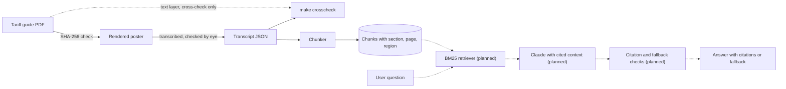

# tariff-rag

Status: in progress. Ingestion and chunking are built; retrieval, answering and the evaluation
runner are not. See [Status](#status).

A question-answering assistant over Co-op Bank Kenya's published tariff guide. The goal: answer
questions like "how much is an agent withdrawal of Ksh 15,000?" with the fee, a citation to the
part of the guide it came from, and a clear "the guide does not cover this" when it does not.

## Problem

Bank tariff guides are dense tables. People look up one fee and get it wrong, or ask a chatbot
that gives a confident answer with no source. A useful assistant here has to:

- quote the exact fee, band and conditions from the guide, not a paraphrase from memory;
- show where in the guide the answer came from, so it can be checked;
- refuse to guess when the guide does not cover the question;
- be measured, so claims about accuracy are backed by numbers.

The source is a single A2 poster, "Co-op Bank Tariff Guide", captured as of 9 September 2026 and
pinned by SHA-256 in `data/source.json`. The PDF is not in the repo; it is downloaded from the
bank's site.

## Architecture



Solid lines are built. Dotted lines are planned.

## Chunking and loading

**The PDF text layer is not used as the source of truth.** `make inspect` showed that the poster,
exported from Adobe Illustrator, draws 17% of its glyphs more than once, contains an old Pesalink
table that is not visible on the poster, and turns the whole Treasury section into punctuation in
every extractor tested. Details are in [DECISIONS.md](DECISIONS.md) 003 and
`reports/inspection.md`.

Instead, the poster is transcribed from rendered crops into `data/transcript/tariff_guide.json`:
one section per table, with column headers, rows, optional sub-headings, and the table's region on
the page. A pydantic schema (`src/tariff_rag/transcript.py`) rejects rows with the wrong number of
cells, regions outside the page, and transcripts made from a different edition.

`make crosscheck` looks for every amount in each transcribed table inside that table's region of
the PDF text layer and lists the ones it cannot find. Current result: all amounts in the four
readable tables are found; all six Treasury amounts are not, as expected. Those rows can only be
checked by eye.

**Chunking keeps tables intact** (`src/tariff_rag/chunking.py`):

- One chunk never mixes two tables.
- Every row is written as `column: value` pairs, so a value never loses its header. The row
  `Above 1,000 | Ksh.20` becomes `Service: Pesalink Transactions | Range (Ksh.): Above 1,000 |
  Cost (...): Ksh.20`, under `Section: Agency Tariff Guide`.
- Tables longer than 12 rows are split into balanced parts, only between items. All seven cash
  withdrawal bands stay in one chunk, as do rows under one sub-heading.
- Chunk ids (`agency-banking-01`) depend only on section and position, so they are stable.

## Retrieval (planned)

Two options were considered:

| | BM25 (`rank-bm25`) | Local embeddings (e.g. bge-small) |
|---|---|---|
| Good at | exact terms: "Pesalink", "RTGS", "Ksh." amounts | paraphrases: "send money to another bank" |
| Cost | misses synonyms the poster does not use | new heavy dependency (torch), harder to explain |

The plan is BM25 first, with a small hand-written synonym list, and to add embeddings only if the
eval shows retrieval misses on paraphrased questions. The whole poster is small enough to fit in a
prompt, so "no retrieval, full context" will also be run as a baseline to check that retrieval
earns its place.

## Citations and fallback (planned)

**Citations.** The guide has one page, so "page 1" alone tells a reader little. Each chunk
carries its page, section title and region on the poster. The model will be asked to cite chunk
ids such as `[agency-banking-01]`; a check will drop any id that was not in the retrieved context
and render the rest as "Page 1, Agency Tariff Guide".

**Fallback.** The answer is replaced with "The tariff guide does not cover this." when any of
these hold:

1. no chunk scores above a retrieval threshold (the model is not called);
2. the model returns the fallback sentinel it is instructed to use when the context lacks the
   answer;
3. the answer has no valid citation.

## Guardrails (planned)

- Every amount in an answer must appear in one of the chunks it cites; otherwise fall back.
- Questions about other banks, exchange rates or financial advice get the fallback, not a guess.
- Inputs are length-limited, and text in a question that tries to override the instructions is
  treated as part of the question, not as instructions.
- Each query logs latency, token usage and cost. Questions are not logged with account numbers or
  other personal details.

## Evaluation

`eval/questions.json` holds 15 questions, all marked **draft** until the owner has checked the
expected answers against the poster:

- 10 answerable questions spread over all transcribed tables, including the Treasury table that no
  text extractor can read;
- 5 that should trigger the fallback: overdraft and mortgage fees (not in the guide), an exchange
  rate, another bank's fee, and a request for a recommendation.

Each question has `expected_values` (strings a correct answer must contain), `expected_section`
and `expected_page`. A test already checks that each expected value appears in the section the
question points at.

Planned scoring, all deterministic:

| Metric | Measures |
|---|---|
| Retrieval hit@k | expected section is in the top k chunks |
| Answer accuracy | all `expected_values` appear in the answer after normalising case and spacing |
| Citation accuracy | the cited section is the expected section |
| Fallback precision and recall | fallback fires on the 5 fallback questions and only on them |

Page accuracy is not reported: with a one-page guide it would always be 100%.

## Status

**Works now**

- `make verify-source` checks the PDF against the pinned SHA-256.
- `make inspect` measures the text layer and renders tiles for visual review.
- Transcript of **column 1 of the poster only**: 6 sections, 62 rows (general notes, card fees,
  agency banking, foreign currency accounts, Treasury and transfers, YEA account). All sections
  are **draft**: transcribed from rendered crops, not yet checked by the owner.
- `make crosscheck` compares transcript amounts with the text layer, region by region.
- Chunking into 10 chunks with section, page and region on each.
- Draft eval set of 15 questions.
- 29 tests and CI running lint and tests.

**Not built yet**

- Transcription of poster columns 2 and 3 (most of the guide).
- Retrieval, answer generation, citation checks, fallback and guardrails.
- FastAPI endpoint.
- Eval runner and results. No accuracy numbers exist yet.

## Run it

```bash
make install
cp .env.example .env   # add your Anthropic API key (not needed yet)
# download the tariff guide named in data/source.json into data/raw/
make verify-source
make check        # lint and tests
make inspect      # text-layer report and poster tiles
make crosscheck   # transcript amounts vs. the PDF text layer
```

Design decisions and the evidence behind them are in [DECISIONS.md](DECISIONS.md).
